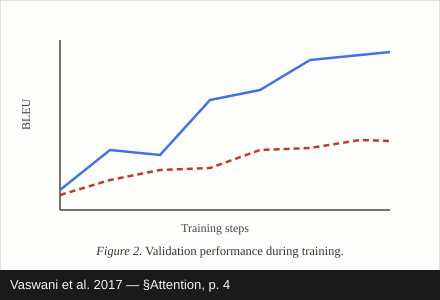
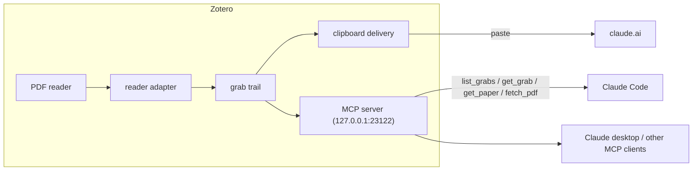
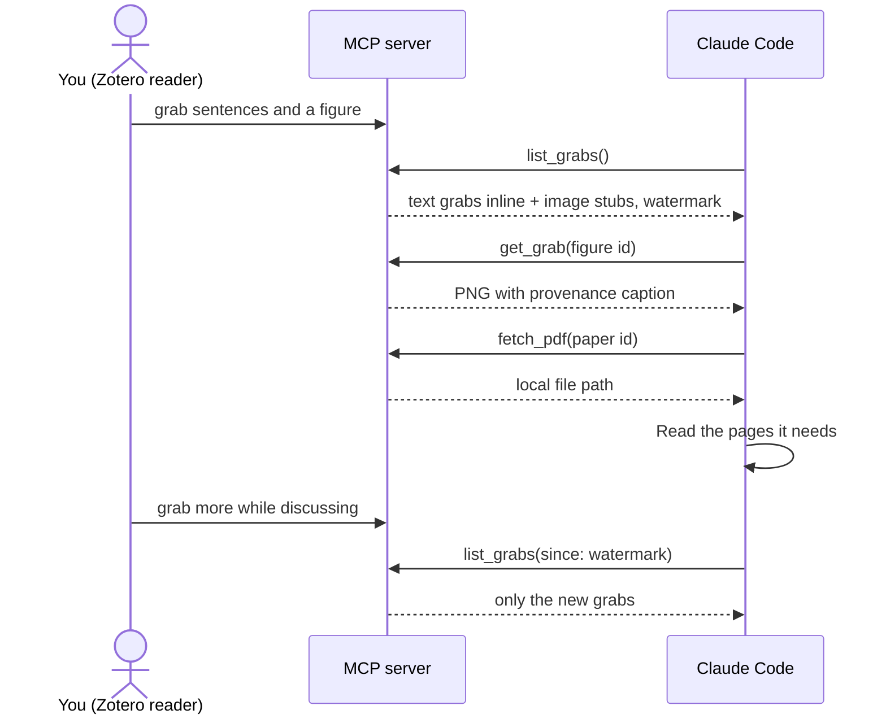

# Zotero Context

[![repo status][repostatus-badge]][repostatus-site]
[![zotero target version][zotero-badge]][zotero-site]
[![Using Zotero Plugin Template][template-badge]][template-repo]
![ci][ci-badge]

A [Zotero][zotero-site] plugin to ferry context for active readers.

When reading a paper and chatting with an AI (claude.ai, Claude Desktop, ChatGPT, ...),
getting context into the chat is arduous:
precisely selecting text, positioning screenshot boxes, remembering section and figure numbers,
and downloading/uploading/introducing the PDF itself.
Zotero Context turns each of those into a click or a hotkey.

Unlike plugins that embed an AI chat inside Zotero,
this plugin has no chat UI of its own, no API keys, and no model calls.
It ferries context to whichever chat you already use:
push it via the clipboard, or let MCP-capable chats
(Claude Code, Claude desktop, OpenAI's Codex CLI, ...) pull it themselves.
It also remembers which chats discussed which papers,
by linking each chat to its paper as a note.

## Features

Everything revolves around **grab mode** in the PDF reader: click the
 button
in the reader toolbar (or press `Ctrl+Alt+G`), and the cursor becomes a crosshair.

- **Sentence snap**: hover text and the sentence under the cursor glows;
  click to copy it as quoted text.
  `Shift`-click a later sentence to extend the grab through a range.
  No drag-selection needed.
- **Two-click area grab**: click two opposite corners of a figure, table, or formula
  to copy that region as an image. `Esc` cancels a pending corner.
- **Provenance on every grab**: the first grab from a paper carries its full citation;
  later grabs carry a compact locator
  (section names come from the PDF outline, embedded or Zotero-generated,
  with page-only fallback).
  A first and a second text grab paste as:

  ```text
  From "Attention Is All You Need" (Vaswani et al. 2017), §Encoder and Decoder Stacks, p. 3:
  > Encoder: The encoder is composed of a stack of N = 6 identical layers. ...

  §Attention, p. 4:
  > An attention function can be described as mapping a query and a set of key-value pairs ...
  ```

  Image grabs carry the same provenance as a caption strip rendered into the image itself,
  since chat inputs take only the image from a mixed paste. A grabbed figure arrives as:

  

- **Session bundle**: grabs accumulate in an in-memory trail.
  `Ctrl+Alt+B` copies everything since your last bundle as one text block
  (image grabs cycle onto the clipboard with repeated presses).
  `Ctrl+Alt+Shift+B` copies a full-session recap for seeding a fresh chat;
  `Ctrl+Alt+X` clears the trail.
- **Start a chat**: click 💬 in the reader toolbar (or press `Ctrl+Alt+I`)
  to start a chat about the paper where you usually chat,
  linked to the paper when possible (see [Chat links](#chat-links)):
  - **Claude Code**: copies a `claude --session-id …` command
    that opens a session already linked to the paper, with the paper's PDF path in its first message.
  - **Claude desktop app** or **claude.ai in your browser**:
    puts the PDF on the clipboard and opens a new chat (or your claude.ai project);
    paste to attach it, then press `Ctrl+Alt+I` again within a minute for the intro message
    (citation + abstract).
  - **claude.ai in Zotero**: opens claude.ai beside the PDF
    with the paper attached and the intro typed in, ready to send.

  Where you chat is the **Preferred chat** setting.
  It starts as **Ask every time**:
  each start asks where to chat, and **Always use this** saves your answer.

- **Sentences come from Zotero's own text layer**: Zotero builds structured text for each document
  with a local layout model (the same text behind Read Aloud and Reading Mode).
  Sentence snap reads it, so sentences follow reading order across columns,
  sentences split by a column or page break still grab whole,
  and running headers, footers, and page numbers are never snap targets.
  Zotero builds it the first time a document is opened;
  until then, and on documents it can't process, area grab still works.

### Hotkeys

| Hotkey             | Action                                            |
| ------------------ | ------------------------------------------------- |
| `Ctrl+Alt+G` or ⌖  | Toggle grab mode in the focused reader tab        |
| Click              | Grab hovered sentence (or place an area corner)   |
| `Shift`+click      | Extend the text grab through the clicked sentence |
| `Esc`              | Cancel pending corner, then exit grab mode        |
| `Ctrl+Alt+B`       | Copy bundle of grabs since last bundle            |
| `Ctrl+Alt+Shift+B` | Copy full-session recap                           |
| `Ctrl+Alt+X`       | Clear the session trail                           |
| `Ctrl+Alt+I` or 💬 | Start a chat about the paper (see Start a chat)   |

## Chat links

A chat link records which AI chat discussed which paper, so you can find and reopen it later.
It's for reference, not citation:
each paper the chat covered gets a child note (tagged `zotero-context/chat`),
and copies of the same chat are connected through Zotero's **Related** field.

```text
Claude chat: Why multi-head beats single-head
Link: https://claude.ai/chat/94a29078-…
Started: 2026-11-19

(your own notes)
```

Links get made two ways:

- **Automatically, when you start a chat from Zotero** (💬 or `Ctrl+Alt+I`):
  - Claude Code sessions are linked the moment the command is copied.
    Starting again on a paper that already has a session offers to resume it,
    and the copied command also starts a session you never got around to running.
  - claude.ai in Zotero links the chat when you send its first message, titled after the chat.
- **By hand**: right-click papers (or a reader tab) → **Link chat…**, then paste a chat link,
  a resume command, or a session ID, or pick a chat that's already linked.
  It recognizes claude.ai, ChatGPT, and Codex links,
  and the resume commands of Claude Code, Codex, Gemini CLI, Qwen Code, Copilot CLI,
  OpenCode, Pi, Cursor CLI, Grok CLI, and Amp;
  for a bare session ID or name, it asks which tool it came from (or "Other…").

Right-click a chat note for **Also link to…** (more papers),
**Edit chat link…** (updates every copy, keeping each copy's own notes),
**Copy resume command**, and **Open chat link**.

Settings → Zotero Context → **Chat links** holds Preferred chat,
an optional claude.ai project for new chats,
whether chats started from Zotero get linked,
and **Link chats in group libraries** (off by default, since group members would see the notes).

Tips:

- **claude.ai in Zotero** needs a one-time sign-in inside the pane: use email sign-in.
  "Continue with Google" fails there with "There was an error logging you in",
  most likely because Google refuses sign-in from browsers embedded in other apps.
- The Claude desktop app opens after Zotero asks "Open the claude link with Claude?".
- Claude Code deletes local sessions after 30 days by default.
  To keep linked sessions resumable for longer, raise `cleanupPeriodDays`
  in Claude Code's settings (e.g. `"cleanupPeriodDays": 365` in `~/.claude/settings.json`).
- Some tools look sessions up per folder (e.g. Gemini CLI),
  so their resume command may need a `cd` into the original folder first.

## MCP server (pull delivery)

The clipboard pushes grabs into a chat; the MCP server lets the chat **pull** them.
Grabs are deliberately lean pointers — a quote or a cropped figure plus a locator —
so the moment a conversation needs more than what you grabbed
("how does this relate to their ablation study?"),
the model can fetch the surrounding context itself:
list your grab trail, pull a figure's pixels, or read the paper's whole PDF from disk,
with no download/upload dance.
This works for MCP clients that can reach your machine — Claude Code, Claude desktop,
OpenAI's Codex CLI, and similar; browser-based chats such as claude.ai cannot connect
to localhost servers, so they use the clipboard flow
(a zero-paste browser extension is the planned v0.2).



A typical pull loop, after you grab a few passages and say
_"take a look at what I've been reading"_:



### Tools

| Tool         | Returns                                                                                                          |
| ------------ | ---------------------------------------------------------------------------------------------------------------- |
| `list_grabs` | The grab trail: text grabs inline, image grabs as stubs; filter by paper or by `since` watermark for delta pulls |
| `get_grab`   | One grab's full payload (images as PNG content)                                                                  |
| `get_paper`  | Metadata + abstract for a paper in the trail                                                                     |
| `fetch_pdf`  | The paper's PDF as a local file path (+ size) for the client to read directly                                    |

Papers are identified by the grab trail, never by which reader tab has focus —
and the server can only serve papers you have grabbed from this session,
or started a Claude Code chat about.

### Setup

The MCP server is **off by default**. Two steps:

1. In Zotero: Settings → Zotero Context → enable **MCP server**.
   The status line should read "Running on 127.0.0.1:23122".
2. Click **Copy Claude Code command** and run it in a terminal — it looks like:

   ```sh
   claude mcp add --transport http zotero-context http://127.0.0.1:23122/mcp \
     --header "Authorization: Bearer <your minted token>"
   ```

   For Claude desktop — or any GUI MCP client that reads `mcpServers` JSON,
   such as Cursor — click **Copy MCP config (JSON)** instead and merge it into
   the client's config file (`claude_desktop_config.json` for Claude desktop).

Why port 23122: it continues the de facto Zotero port block — 23119 is Zotero's own
connector server and 23120 is [zotero-mcp][zotero-mcp]'s — while skipping 23121, which
several AI-bridge plugins already bind
([zotero-filelink-bridge][filelink-bridge], [zotero-notebooklm][notebooklm],
[aiops-lmstudio-zotero-plugin][lmstudio-bridge]).
The port is a setting in the same pane if 23122 is taken on your machine.

Troubleshooting:

- **Status says the port is in use**: another app owns the port — change it in
  the same pane (the copy buttons regenerate commands with the new port).
- **401s after an update**: some clients drop configured headers; click
  **Copy token** and re-add the header manually.
- **Windows Zotero + WSL chat client**: `fetch_pdf` and Claude Code intros give Windows paths
  (`C:\...`); Claude Code in WSL translates them to `/mnt/c/...` itself.

### Security

Off by default; binds `127.0.0.1` only with `Host`/`Origin` rejection
(DNS-rebinding defense); a bearer token on every request; retrieval scoped to
papers grabbed (or started a Claude Code chat about) this session — in the spirit of the
[MCP transport security guidance][mcp-security].
Project-wide security model, data flows, and accepted risks: [SECURITY.md](SECURITY.md).

## Limitations (current)

- Grabs are ephemeral: they're never written to your library, and the trail resets with Zotero.
  The only library writes are the chat-link notes you create.
- Hotkeys are fixed for now; preferences for bindings and press-and-hold are planned.
- Element-picking (click a figure to auto-bound it) is on the roadmap.

## Installation

- Encouraged: install in-app via the [Zotero Addons][zotero-addons] plugin marketplace
- Manual:
  1. Download the latest `.xpi` from [this repo's GitHub Releases][releases]
  2. install it via Zotero's Tools → Plugins menu

## Development

See [CONTRIBUTING.md](CONTRIBUTING.md).

## License

[AGPL-3.0-or-later](LICENSE).
Built from [zotero-plugin-template][template-repo].

[ci-badge]: https://github.com/jamesbraza/zotero-context/actions/workflows/ci.yml/badge.svg
[releases]: https://github.com/jamesbraza/zotero-context/releases
[repostatus-badge]: https://www.repostatus.org/badges/latest/wip.svg
[repostatus-site]: https://www.repostatus.org/#wip
[filelink-bridge]: https://github.com/ImagonTuTu/zotero-filelink-bridge
[lmstudio-bridge]: https://github.com/sachajw/aiops-lmstudio-zotero-plugin
[mcp-security]: https://modelcontextprotocol.io/specification/2025-06-18/basic/transports#security-warning
[notebooklm]: https://github.com/iuliaturc/zotero-notebooklm
[zotero-mcp]: https://github.com/cookjohn/zotero-mcp
[template-badge]: https://img.shields.io/badge/Using-Zotero%20Plugin%20Template-blue?style=flat-square&logo=github
[template-repo]: https://github.com/windingwind/zotero-plugin-template
[zotero-addons]: https://github.com/syt2/zotero-addons
[zotero-badge]: https://img.shields.io/badge/Zotero-10-green?style=flat-square&logo=zotero&logoColor=CC2936
[zotero-site]: https://www.zotero.org
